# 🦮 DogVisor Mobile — FrontEnd

Aplicativo mobile para a gestão operacional e clínica do **Centro de Treinamento de Cães-Guia do IF Goiano — Campus Urutaí**.

O **DogVisor** é a interface mobile conectada ao ecossistema de microsserviços **Dog-Vision**, desenvolvida para atender às rotinas diárias de coordenadores, veterinários, treinadores e colaboradores do centro.

---

## 📌 Sobre o Projeto

O treinamento e acompanhamento de cães-guia exige um controle rigoroso de saúde, estoque, eventos clínicos e evolução de cada animal. O **DogVisor** centraliza e simplifica essas operações em um aplicativo móvel moderno, intuitivo e com controle de acesso baseado em papéis (RBAC).

### 🔗 Integração com o Backend (Dog-Vision)
O aplicativo consome a arquitetura de microsserviços Java / Spring Boot do **Dog-Vision**:
- **Cloud Gateway:** Roteamento unificado e segurança das requisições HTTP e WebSockets.
- **Service User:** Autenticação JWT, gerenciamento de perfil e permissões de usuários/colaboradores.
- **Service DogManagement:** Cadastro, listagem e acompanhamento das informações dos cães.
- **Service DogHealth:** Prontuário clínico, consultas, cirurgias, partos, pesagens, massagens, planos de alimentação, controle reprodutivo e gestão farmacêutica.
- **Service DogTraining:** Gestão das 4 etapas do treinamento de cão-guia, testes de aptidão Volhard e avaliações comportamentais (Behavior Checklist).
- **Service Notification:** Central de avisos, alertas clínicos e prescrições em tempo real via WebSocket.
- **Service Audit & RabbitMQ:** Rastreabilidade e logs de ações no sistema.

---

## 🚀 Funcionalidades Principais

### 🏢 Módulo do Coordenador (`ROLE_COORDINATOR`)
- **Gestão de Colaboradores:** Cadastro e listagem de membros da equipe com campos profissionais dinâmicos por função (`CRMV` e `Especialidade` para Veterinários; `Especialidade` para Treinadores), alteração de cargos/permissões e ativação/desativação de contas.
- **Controle de Estoque de Ração:** Cadastro de lotes, incremento/baixa manual de estoque em kg, **baixa diária automatizada (individual ou geral em lote)** baseada nos planos alimentares vigentes, proteção contra exclusão de rações vinculadas a planos ativos, alertas de estoque crítico e estimativa preditiva de consumo diário e dias restantes.
- **Painel de Ações Rápidas (Home):** Indicadores em tempo real (colaboradores ativos, cães ativos, estoque total de ração em kg e previsão do próximo cio) e atalhos operacionais.

### 🩺 Módulo do Veterinário (`ROLE_VETERINARIAN`)
- **Gestão de Medicamentos:** Cadastro de medicamentos veterinários, controle de estoque (comprimidos, ml, doses), prescrições e registro de administrações por cão.
- **Controle Reprodutivo e Ciclo de Cio:** Monitoramento de matrizes fêmeas (com bloqueio de cadastros duplicados), cálculo automático de status do ciclo (`Em Cio Ativo`, `Próximo em X dias`, `Previsão Vencida`), atualização rápida de ciclo e filtro para cios previstos nos próximos 30 dias.
- **Planos de Alimentação:** Criação e gestão de planos alimentares individuais com ajuste rápido de porção em gramas diretamente na listagem (`-` / `+`), filtros entre cães `No Canil` e `Todos com Plano`, cálculo em tempo real do impacto no estoque e sincronização com cache local de contingência.
- **Agenda e Procedimentos Clínicos:** Calendário interativo mensal com sincronização em tempo real via WebSocket (RabbitMQ), agendamento e registro de consultas normais, atendimentos de emergência, cirurgias e partos.
- **Prontuário e Histórico de Saúde:** Acompanhamento de evolução de pesagem com gráficos comparativos, sessões de massagem, histórico médico e tratamentos em andamento.

### 🦮 Módulo do Treinador / Adestrador (`ROLE_TRAINER`)
- **Gestão de Treinamento (Etapas 1 a 4):** Registro diário de sessões (até 21 sessões por etapa) com checklist de exercícios por etapa, aprovação (`Apto`) ou encerramento (`Inapto`), identificação automática do treinador responsável, histórico completo de evolução e **suporte Offline-First** com fila de sincronização automática.
- **Teste de Aptidão Volhard:** Aplicação dos 9 subtestes comportamentais e dos 6 itens de estrutura física com ilustrações anatômicas de referência (com zoom e preenchimento rápido em lote), guia de interpretação integrado e destaque visual (`Não feito`) para itens pendentes.
- **Teste Comportamental (Behavior Checklist):** Avaliação estruturada dos 51 aspectos comportamentais com busca rápida, progresso automático, rastreabilidade do avaliador e destaque visual (`Não feito`) para itens ainda não preenchidos.

### 🐾 Módulo do Colaborador (`ROLE_COLLABORATOR`)
- **Cuidados de Filhotes:** Listagem automática de filhotes (< 18 meses), indicadores de quantidade e peso médio, registro rápido de **Pesagem** (com gráfico de evolução e comparativo com a última pesagem) e **Sessões de Massagem** com modelos rápidos de observação.

### 👥 Recursos Compartilhados
- **Gestão e Ficha Completa dos Cães:** Cadastro de novos cães, classificação automática de faixa etária (`Filhote`, `Adulto`, `Idoso`), visualização de prontuário detalhado (identidade, saúde, pesagem/massagem, controle reprodutivo, treinamento e testes Volhard/Behavior com identificação do treinador), alteração de status do animal e busca com filtros.
- **Central de Notificações e Prescrições em Tempo Real:** Mural de avisos e notificações via WebSocket sobre alertas críticos de estoque, medicamentos, prescrições e agendamentos, com confirmação de conclusão de tarefas em tempo real.
- **Perfil do Usuário:** Visualização dos dados de cadastro, informações profissionais e contato.
- **Navegação Dinâmica (RBAC):** As abas e rotas da aplicação se adaptam dinamicamente de acordo com o nível de acesso do usuário autenticado.

---

## 📱 Capturas de Tela (Screenshots)

<details>
<summary><b>📸 Visualizar todas as Capturas de Tela do Aplicativo (14 imagens — clique para expandir)</b></summary>
<br/>

### 🏢 Módulo do Coordenador
| Painel do Coordenador | Gestão de Rações | Cadastro de Funcionário | Controle Reprodutivo |
| :---: | :---: | :---: | :---: |
| 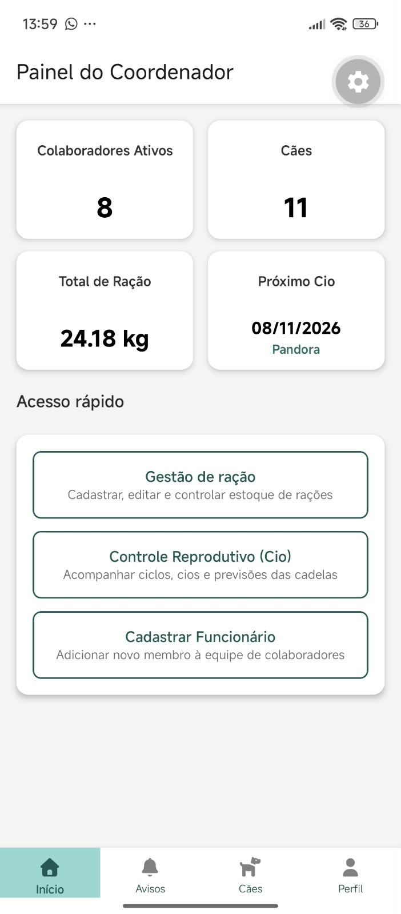 | 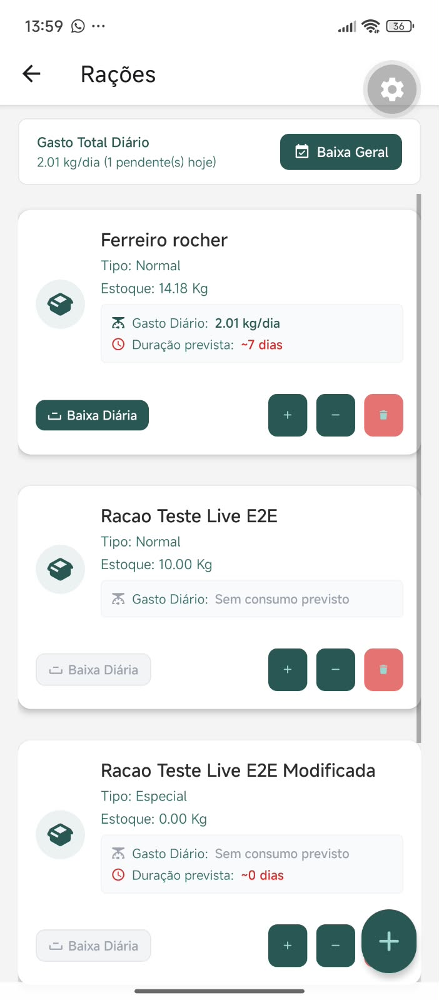 | 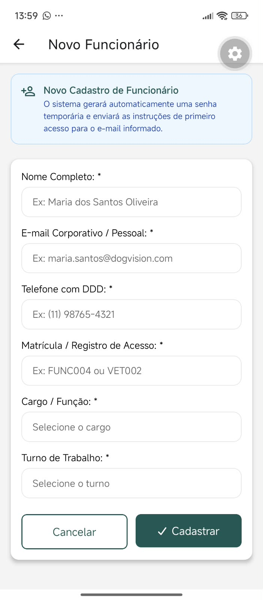 | 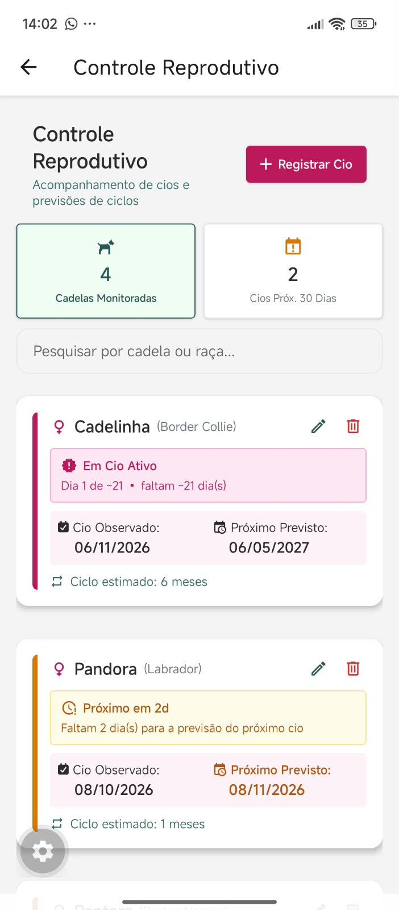 |

### 🩺 Módulo do Veterinário
| Eventos & Agenda | Gestão de Alimentação |
| :---: | :---: |
| 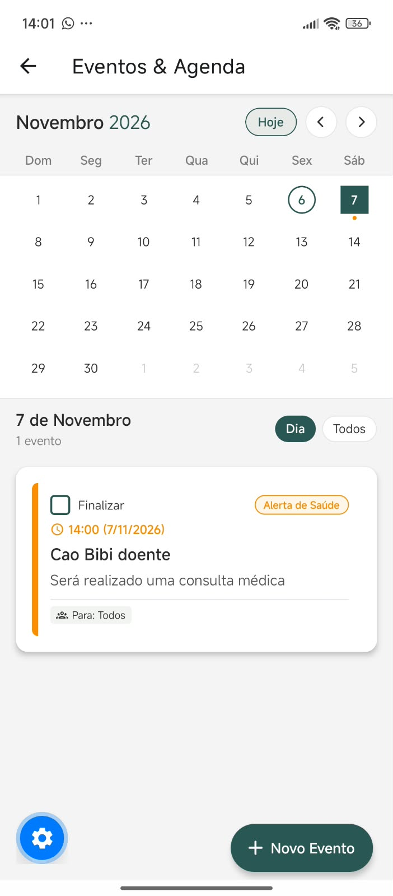 | 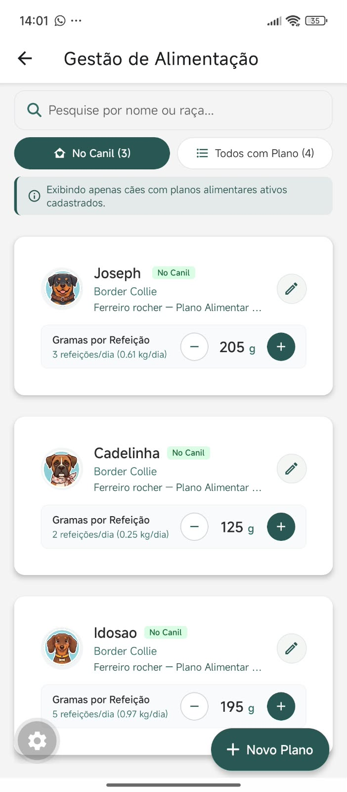 |

### 🦮 Módulo do Treinador / Adestrador
| Gestão de Treinamento | Teste Volhard (Menu) | Estrutura Volhard (Parte 1) | Estrutura Volhard (Parte 2) |
| :---: | :---: | :---: | :---: |
| 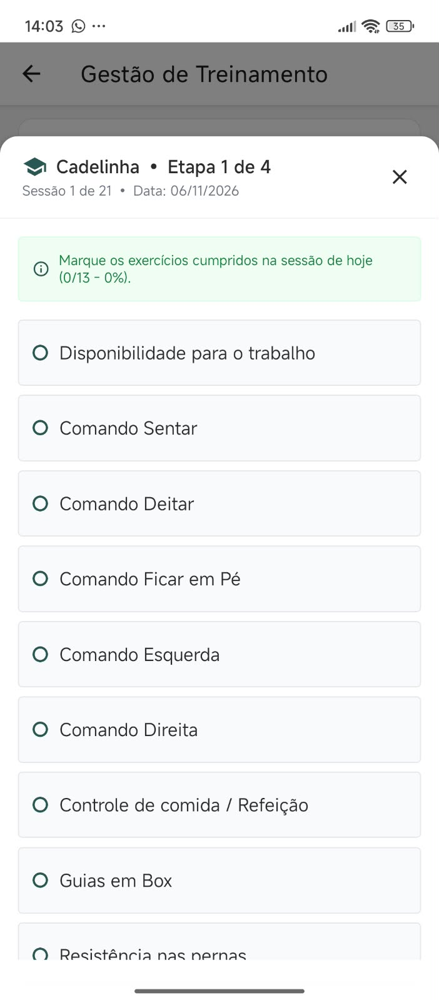 | 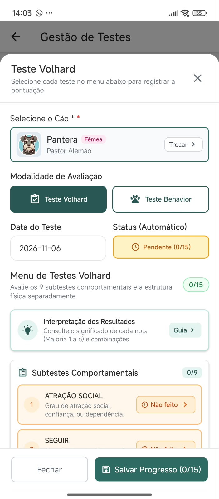 | 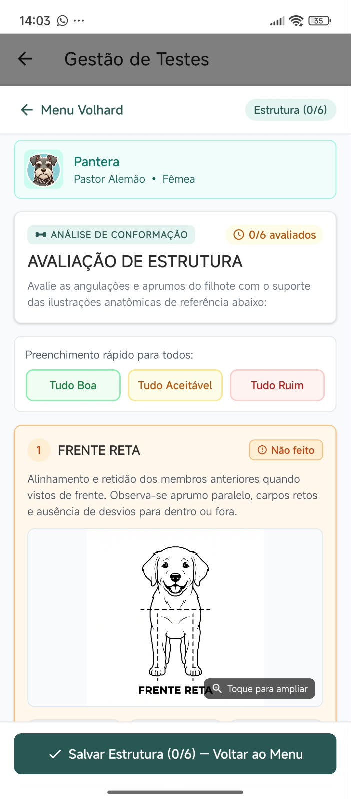 | 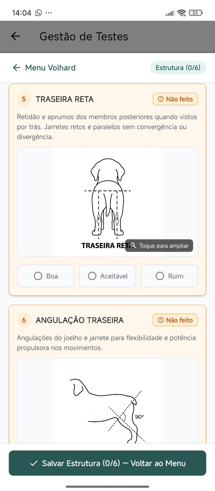 |

### 🐾 Módulo do Colaborador
| Registro de Massagem | Registro e Evolução de Pesagem |
| :---: | :---: |
| 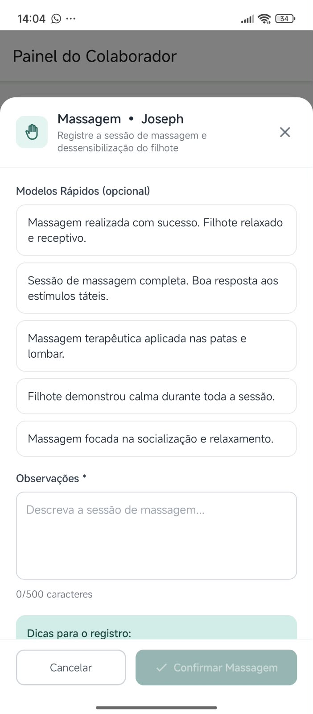 | 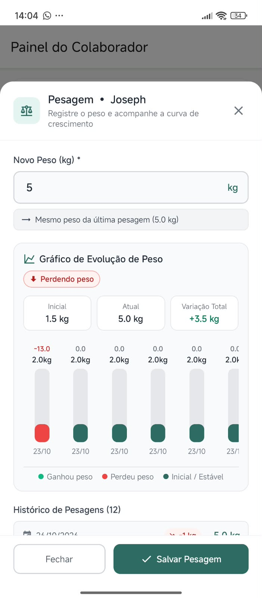 |

### 👥 Recursos Compartilhados (Cães & Avisos)
| Lista de Cães | Mural de Avisos |
| :---: | :---: |
| 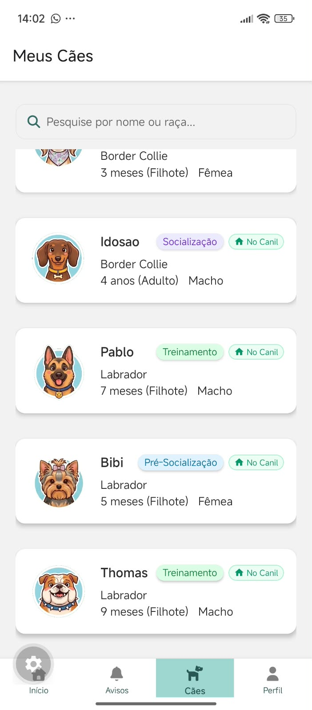 | 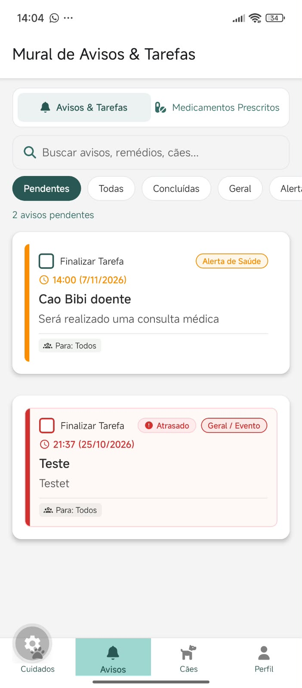 |

</details>

---

## 🛠️ Tecnologias Utilizadas

- **Framework:** [React Native](https://reactnative.dev/) com [Expo](https://expo.dev/) (SDK 56)
- **Linguagem:** [TypeScript](https://www.typescriptlang.org/)
- **Navegação:** [React Navigation 7](https://reactnavigation.org/) (Stack Navigation & Dynamic Bottom Tabs)
- **Comunicação HTTP:** [Axios](https://axios-http.com/) com interceptors para injeção de tokens JWT
- **Tempo Real:** WebSocket nativo para entrega instantânea de notificações
- **Armazenamento Seguro:** `expo-secure-store` para persistência encriptada de tokens de autenticação
- **Ícones e UI:** `react-native-vector-icons`, `expo-image`, `expo-blur` e `expo-video`

---

## 📂 Estrutura de Pastas

```text
dog-visor-front-end/
├── assets/                  # Imagens, logos, ícones e ilustrações anatômicas
├── github/                  # Capturas de tela do aplicativo para documentação
├── src/
│   ├── consts/              # Constantes de telas, rotas e ícones de cães
│   ├── hooks/               # Custom hooks React (alertas, estados)
│   ├── navigation/          # Configuração de StackNavigator e TabNavigator (RBAC)
│   ├── screens/             # Telas divididas por domínio de acesso
│   │   ├── auth/            # Login e autenticação
│   │   ├── colaborator/     # Painel de cuidados de filhotes (pesagem e massagem)
│   │   ├── coordinator/     # Gestão de colaboradores, rações e indicadores rápidos
│   │   ├── dogs/            # Listagem, cadastro e prontuário detalhado dos cães
│   │   ├── notifications/   # Central de avisos e prescrições em tempo real
│   │   ├── profile/         # Perfil do usuário autenticado
│   │   ├── trainer/         # Gestão de treinamento (4 etapas) e testes Volhard/Behavior
│   │   ├── veterinarian/    # Medicamentos, agenda clínica, alimentação e reprodução
│   │   └── SplashScreen.tsx # Tela de carregamento e validação de sessão
│   ├── service/             # Serviços da API Axios, WebSocket e sincronização offline
│   ├── shared/              # Componentes reutilizáveis (Botões, Modais, Seletor de Cães)
│   ├── types/               # Tipagens e interfaces TypeScript (Dog, Training, Health, User)
│   ├── utils/               # Utilitários de idade, avatares e cálculo de ciclo reprodutivo
│   └── routes.tsx           # Ponto de entrada das rotas da aplicação
├── theme/                   # Paleta de cores, tipografia e estilos globais
├── .env                     # Variáveis de ambiente da aplicação
├── App.tsx                  # Componente raiz
└── package.json             # Dependências e scripts do projeto
```

---

## ⚙️ Pré-requisitos

Antes de iniciar, você precisará ter instalado em sua máquina:
- [Node.js](https://nodejs.org/) (versão 18 ou superior recomendada)
- [npm](https://www.npmjs.com/) ou [yarn](https://yarnpkg.com/)
- [Expo Go](https://expo.dev/go) instalado em seu dispositivo móvel (Android/iOS) ou um emulador configurado (Android Studio / Xcode).
- Instância do backend **Dog-Vision** em execução (ou acessível via rede local).

---

## 🚀 Como Executar o Projeto

### 1. Clonar o repositório
```bash
git clone https://github.com/GarotoCowboy/dog-visor-front-end.git
cd dog-visor-front-end
```

### 2. Instalar as dependências
```bash
npm install
```

### 3. Configurar as Variáveis de Ambiente
Crie um arquivo `.env` na raiz do projeto informando o IP e a porta de acesso ao **Cloud Gateway** do backend:

```env
EXPO_PUBLIC_BACKEND_ADDRESS=192.168.X.X
EXPO_PUBLIC_BACKEND_PORT=XXXX
```

> 💡 **Dica:** Utilize o IP local da sua máquina na rede (ex: `192.168.X.X`) para que o aplicativo consiga se comunicar com o backend quando executado em um celular físico via Expo Go.

### 4. Iniciar o servidor de desenvolvimento Expo
```bash
npm start
```

Ou diretamente na plataforma desejada:
```bash
npm run android   # Iniciar no emulador Android
npm run ios       # Iniciar no simulador iOS (macOS)
npm run web       # Iniciar versão Web
```

---

## 🔒 Perfis de Acesso (Roles)

| Role | Descrição |
| :--- | :--- |
| `ROLE_COORDINATOR` | Gestão de colaboradores, estoque de ração, indicadores do centro e cadastro de cães. |
| `ROLE_VETERINARIAN` | Gestão de medicamentos, prescrições, controle reprodutivo/cio, planos alimentares e agenda clínica. |
| `ROLE_TRAINER` | Gestão das 4 etapas de treinamento de cão-guia (online/offline) e aplicação dos testes Volhard e Behavior. |
| `ROLE_COLLABORATOR` | Cuidados diários de filhotes (registro de pesagem e massagem), consulta de cães e central de avisos/prescrições. |

---

## 🎓 Contexto Acadêmico

Projeto desenvolvido como Trabalho de Conclusão de Curso (TCC) no **Instituto Federal Goiano — Campus Urutaí**, voltado ao suporte tecnológico e otimização dos processos do projeto de cães-guia da instituição.

